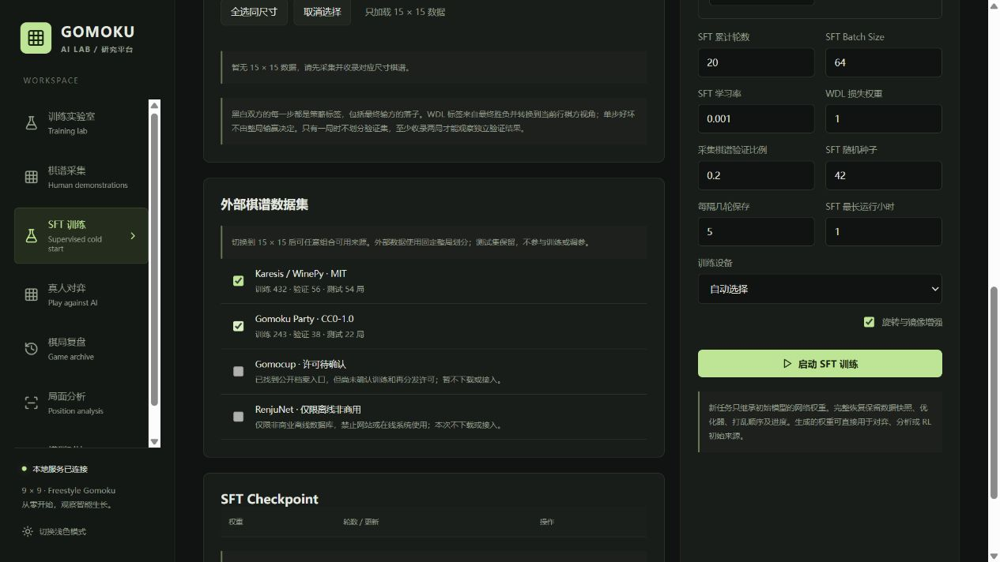

# 15×15 Gomoku 数据管线与 SFT 接入

已于 **2026-10-21** 检查官方来源。只接入已确认允许使用的 Karesis 和 Gomoku Party；四个来源均有独立 adapter，受限来源失败即停止，不会偷偷回退到镜像或爬取。

## 实测来源与许可

| 来源 | 实际取得 | 格式 / 棋盘 / 规则 | 使用边界 |
|---|---|---|---|
| [Karesis/Gomoku](https://huggingface.co/datasets/Karesis/Gomoku) | `complete_games.json`，139,949 bytes，875 条对局序列；固定 revision `5cf594efdcddcba688965e3bdcab37f2a89d714b` | 带符号整数 JSON，15×15；正黑负白；坐标 `abs(v)=y*15+x`；没有结果字段 | 数据卡声明 MIT；保留数据卡和 WinePy MIT 通知。规则按 WinePy 实现推断为 freestyle，数据卡没有正式规则标识。并非人类高手棋谱，单一 AI 自弈。 |
| [Gomoku Party](https://gomokuparty.com/database/) | 2026-08 / 2026-09 两个 gzip 档案，共 632 局；两份均与官方 manifest 完整 SHA-256 一致 | SGF FF4/GM4，15×15；混合 freestyle / Swap2 / Renju / Caro / capture variants | 官方明确 CC0、允许训练；本版本只纳入 freestyle；其他规则保留原始档案并隔离。 |
| [Gomocup](https://gomocup.org/results/gomocup-result-2026/) | 2026 ZIP 的 HEAD 返回 200、application/zip、76,001,590 bytes；**没有下载档案正文** | 官方页面区分 15×15、20×20 及多规则；ZIP 内部格式、历史各年数量未验证 | 找到公开下载/回放说明，未找到明确授权训练及再分发的数据许可；因此阻止自动下载与 SFT 接入。程序源码许可不能代替赛事数据许可。 |
| [RenjuNet](https://www.renju.net/game/) | 只检查页面上的下载格式及限制；**没有请求 XML/XML.GZ 数据库** | 页面提供 XML / XML.GZ；内部字段、坐标和逐局规则均未验证 | 仅限非商业离线数据库，禁止网站/在线系统使用原内容及修改版本。此项目的共享 SFT/网页工作流没有明确授权，adapter 永久拒绝当前用途。 |

Party 的具体发布格式见 [官方 profile 2](https://gomokuparty.com/database/format.html)。RenjuNet 的历史解释见 [官方下载公告](https://www.renju.net/news/245/)。不存在 RenjuNet 授权绕过参数。Gomocup 的 `parse_psq()` 是**合成 fixture 测试的预备解析器**，要求显式提供坐标基准、规则、结果及来源；它没有经真实历史档案验证。RenjuNet 只有权限 gate，没有伪造 XML 解析成功记录。未来取得针对训练/网页系统/再分发的书面许可后，需重新审核和补充真实格式测试，不能仅修改一个开关。

Gomocup 的[历史结果索引](https://gomocup.org/results/)列出年度赛事；本次只对 2026 档案做了 HEAD 可用性检查，不代表全部历史 ZIP 都可用。

## 本次处理结果

| 来源 | 输入局 | 隔离局 | 重复局（含旋转镜像） | 可用唯一局 |
|---|---:|---:|---:|---:|
| Karesis | 875 | 5 | 328 | 542 |
| Gomoku Party | 632 | 329 | 0 | 303 |
| 合计 | 1,507 | 334 | 328 | **845** |

隔离原因：Karesis 有 2 局 signed zero 无法可靠区分颜色，3 局重复占点。Party 有 Swap2 320 局、Renju 4 局、Caro 4 局、Ninuki Renju 1 局，均不符合当前训练规则。**不删除或修补原始档案。**

固定 seed=42、比例 80/10/10，按去重后的完整棋局哈希分配，实际得到：

| 集合 | 局 | 落子样本 |
|---|---:|---:|
| train | 675 | 22,297 |
| validation | 94 | 2,775 |
| test | 76 | 2,253 |
| 合计 | **845** | **27,325** |

这是哈希分桶，比例为期望值，不保证整数精确 80/10/10。测试集不参与 SFT 或调参。原始 Karesis 上游 train/test 文件没有重复下载，本管线重新建立统一划分。共享开局的不同棋局可能跨集合；已排除完整对局及其 D4 等价重复，未宣称按玩家/开局家族完全隔离。

## 安装、下载、构建（PowerShell）

从项目目录执行。采集/规范化只需要 Python 3.11+ 标准库，无需下载新的 Python 包；训练使用项目已有虚拟环境。

```powershell
Set-Location 'D:\codes\Projects\Gomoku AI Lab'
$python = '.\.venv\Scripts\python.exe'

# 查看四个来源的许可状态和固定版本
& $python -m gomoku_data status

# 按已锁定的官方 URL 和 SHA-256 下载（有正确缓存则不重复传输）
& $python -m gomoku_data download --sources karesis gomoku_party

# 离线复核已附带的缓存，无网络请求
& $python -m gomoku_data download --sources karesis gomoku_party --offline

# 生成新目录；若 normalized 已存在，请另选输出目录，防止混入旧结果
& $python -m gomoku_data build --out data/external_gomoku/rebuilt

# 对比复现结果（没有生成时间戳，内容应相同）
Compare-Object (Get-Content data/external_gomoku/normalized/manifest.json) (Get-Content data/external_gomoku/rebuilt/manifest.json)

# 任意选择可用来源，导出某一集合的监督样本
& $python -m gomoku_data export --sources karesis --split train --out work/karesis-train.jsonl
& $python -m gomoku_data export --sources gomoku_party --split validation --out work/party-validation.jsonl
& $python -m gomoku_data export --sources karesis gomoku_party --split train --out work/combined-train.jsonl

# 受限来源会在任何下载请求之前报错退出（退出码 2）
& $python -m gomoku_data download --sources renjunet
```

全局 `--root` 和 `--lock` 必须放在子命令之前；默认分别为 `data/external_gomoku` 和 `datasets/gomoku/sources.lock.json`。`build --sources ...` 可覆盖 `config.json` 的选择。CLI 的所有导出/构建目录都要求新建或为空，避免误覆盖；源文件损坏则构建失败，下载只原子替换校验成功的 `.part` 文件。

冻结清单保证复现本次版本，**不会自动纳入未来月份**。更新时先重新检查 Party `/api/v1/database`、profile 和许可，或 HF 新 revision；审核新文件 URL、大小、SHA-256 后更新 lock，并写入新输出目录。不要通过改哈希来接受来源不明文件。

## 页面与训练

重新启动后端并使用最新前端。在 **SFT 训练 → 棋谱分类 → 15×15 → 外部棋谱数据集** 勾选 Karesis、Gomoku Party，支持单独使用或组合，也可与本地采集的 15×15 棋谱组合。Gomocup、RenjuNet 显示不可用原因。现有 9×9、13×13 采集和训练继续可用。

训练配置增加可选字段：

```json
{"external_sources":["karesis","gomoku_party"],"dataset_ids":[],"model":{"size":15}}
```

这只是配置片段，其他模型/资源参数按现有 `SFTConfig` 设置。`GET /api/sft/sources` 返回许可状态和每来源的 train/validation/test 局数。后端再次验证来源、棋盘尺寸、规则、规范化文件校验和、每局合法性与划分；不能通过直接调用 API 混入受限来源或 9×9/13×13 权重。外部固定验证集不受“采集棋谱验证比例”影响。

完整可运行配置见 `datasets/gomoku/sft.external.example.json`。以下命令会启动实际训练，输出到现有 GOMOKU_DATA 存储；smoke 命令使用独立工作目录：

```powershell
& $python -m gomoku.cli serve
# 或关闭服务后在终端直接训练
& $python -m gomoku.cli sft --config datasets/gomoku/sft.external.example.json
# 重放本次真实数据验收，约一轮小型 CPU 模型；目录必须是新的
& $python scripts/external_data_smoke.py --work work/external-smoke-replay --report work/external-smoke-replay.json
```

外部棋谱在训练启动时成为 checkpoint 内的不可变游戏快照（含 provenance、license、aliases、external_split）；完整恢复使用快照，不重新读取改变后的外部库。测试局不进入训练快照。本地采集棋谱与所选外部库 train/validation/test 的 D4 等价重复被排除，胜负冲突则拒绝启动。

Party 的认输/超时局保留原始历史结果，终局盘面未必连成五；它们可提供策略和 WDL 标签。Karesis 没有结果，只能在严格重放产生连五/满盘终局时推导结果。禁止将未终局序列的最后落子方当赢家。两方每一步均作为模仿标签；胜方并不意味着其每手最佳，输方动作也不是负策略标签。WDL 是实际或重放得到的最终结果，按当前行棋方视角转换。

## 格式、校验与文件

- `gomoku_data/adapters/`：四个独立来源入口。
- `datasets/gomoku/sources.lock.json`：URL、固定 revision、bytes、SHA-256、许可与 blocker。
- `data/external_gomoku/acquisition.json`：下载/缓存逐文件验证收据。
- `data/external_gomoku/raw/`：原始未改文件。
- `data/external_gomoku/normalized/manifest.json`：计数、隔离原因、完整 config、产物校验和。
- `games.jsonl`：去重后的完整对局；`*.games.jsonl`：整局划分；`*.sft.jsonl`：每一步的 history/target/WDL。
- `quarantine.jsonl`：来源、定位、原因和原始记录；`duplicates.jsonl`：重复对局索引；每局 `aliases` 保留全部来源及许可。
- `game.schema.json`、`example.game.json`、`example.sft.json`：机器可读规范与实际示例。
- `evidence/`：已获取许可/格式元数据和下载验证日志；无 RenjuNet 数据库或游戏页面正文副本。

坐标统一为左上角 `(x=0,y=0)`，x 向右、y 向下，`action=y*15+x`，不跳过 I 列。moves 中 `ply` 从 0 开始，`color` 为 `black`/`white`；winner 为 `black`/`white`/`draw`。Karesis 原始整数列表保存在 metadata；Party root 属性（模式、时间、原始结果等）保留。采集数据不使用 pickle，也不执行下载内容。

严格检查棋盘/规则、颜色交替、重复占点、越界、终局后落子、结果冲突、SGF 必需属性和版本、标注步数、setup/capture/pass/variation。没有把 Swap2 特殊开局错误改成黑白交替；它及捕获/禁手规则均进入 quarantine。去重哈希保留颜色和落子顺序，使用旋转/镜像最小表示，结果不进入身份哈希；同序列不同赢家全部隔离。选择来源时检查 aliases，跨来源同局只出现一次且划分不变。

## 验证命令

```powershell
& $python -m unittest discover -s tests_data -v
& $python -m pytest tests tests_data -q
Set-Location frontend
npm run build
```

若在受限执行环境里运行，把 TMPDIR 指向当前工作区的可写临时目录；普通本地运行不需要。`tests_data` 无网络依赖，覆盖格式/转义、坐标、双方胜负、WDL、坏数据、规则、重复/冲突、固定划分、许可阻断和校验和损坏；项目 tests 另验证页面 API、真实 CPU SFT 更新、checkpoint 数据快照与测试集排除。实际下载 corpus 的训练 smoke 结果见 `validation.json`（完成后生成）。

最终验收：98 tests passed、20 subtests passed；有一条现有 Starlette/httpx 弃用提示。前端 production build 成功。真实 corpus 的小型 CNN 完成 1 epoch、88 updates，policy/value 两头均改变，76 局 test 完全排除。空缓存下载和离线重建均通过，三种可用来源组合的划分稳定。这是管线可用性验收，不是棋力测评。


